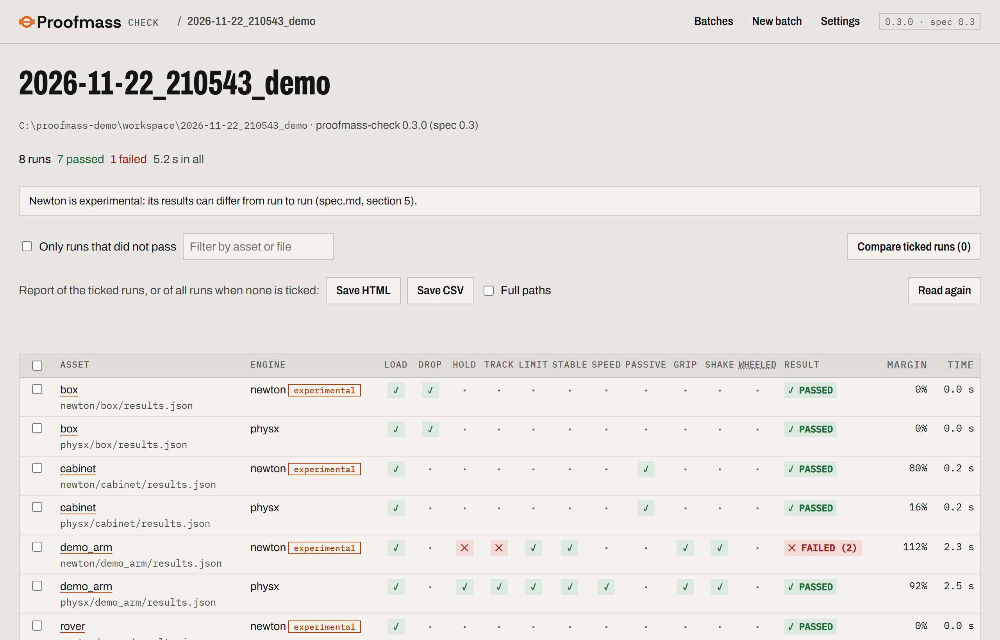
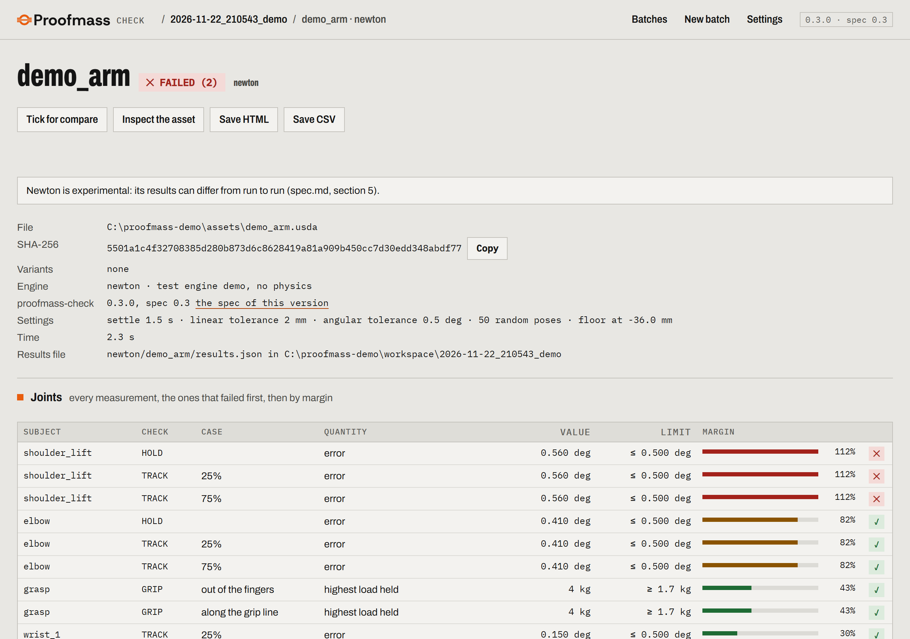
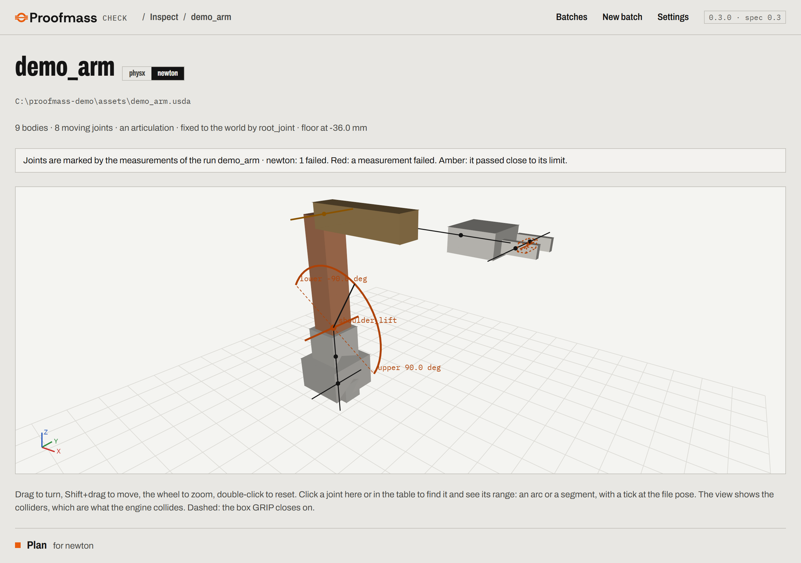

# proofmass-check

**Does this asset behave in a simulator?**

proofmass-check runs a fixed set of physics checks on a SimReady OpenUSD asset: it does not fall
through the floor, its drives hold and reach their targets, its doors and drawers open, its gripper
holds its rated payload. Each check has one pass rule and fixed numbers, written in
[docs/spec.md](docs/spec.md).

A metadata validator tells you that an asset follows the rules. proofmass-check tells you what the
asset does when physics runs.

> **Status: alpha, in development.** The checks run in PhysX (Isaac Sim 6.1) and, as an
> experiment, in Newton. The rules and numbers may still change before version 1.0; each change
> raises the spec version.

## The checks

| ID | What it checks | Runs on |
|---|---|---|
| `LOAD` | The engine builds every joint and the same total mass as the USD | every asset |
| `DROP` | Dropped from 10 cm, it comes to rest on the floor | assets that are not fixed to the world and have no position drives |
| `HOLD` | Drives hold the rest pose under gravity | joints with a position drive |
| `TRACK` | Drives reach 25 % and 75 % of their range | driven joints with limits |
| `LIMIT` | Limits stop a drive commanded past them | driven joints with limits |
| `STABLE` | No explosion in random poses inside the limits | driven joints with limits |
| `SPEED` | At a 60 Hz physics step, drives stay under their speed limits | driven joints with limits and a speed limit |
| `PASSIVE` | A door or drawer, pushed, reaches both limits and stops there | limited joints without a position drive |
| `GRIP` | The gripper holds 85 % of its rated payload, pulled two ways | gripper sites (NVIDIA rules GR.001 to GR.004) |
| `SHAKE` | The grip holds that load shaken at up to 2 g | gripper sites |
| `STAND` | Dropped with its wheels braked, it stands upright and still | wheeled robots |
| `DRIVE` | It drives straight along +X at the commanded speed | wheeled robots |
| `TURN` | It turns in place at the expected rate | differential and skid-steer robots |
| `STEER` | It drives the circle its steering gives | Ackermann robots |

A check that does not apply to an asset reports `N/A` with the reason. `N/A` does not fail a run.

A wheeled robot needs a short description of its wheels in the USD: see
[docs/wheeled-robots.md](docs/wheeled-robots.md).

## Engines

| Engine | Status | Runs in | Not yet |
|---|---|---|---|
| `physx` | reference engine | Isaac Sim 6.1's Python | joints between free rigid bodies get LOAD, DROP and PASSIVE only |
| `newton` | experimental, needs an NVIDIA GPU; results can differ from run to run ([spec, section 5](docs/spec.md#5-engines)) | a Python with `newton[sim,importers]` | SPEED; STAND, DRIVE, TURN, STEER; the single axes of a D6 joint; PhysX joint friction (`physxJoint:jointFriction`), which a note names |

proofmass-check runs in the Python environment that has the engine. It does not look for other
Python installations.

**NVIDIA license.** Isaac Sim asks you to accept the NVIDIA Omniverse License Agreement the first
time it starts. proofmass-check never accepts it for you.

## Install

Install it in the Python environment of your engine: Isaac Sim's Python for `physx`, or the Python
that has Newton for `newton`.

```bash
pip install proofmass-check
```

The development version, from GitHub:

```bash
pip install "proofmass-check @ git+https://github.com/proofmass/proofmass-check"
```

## Run

```bash
proofmass-check run path/to/asset.usd --engine physx
proofmass-check run a.usd b.usd c.usd --engine physx --out results
proofmass-check list-checks
```

| Option | What it does |
|---|---|
| `--engine physx` or `newton` | the engine to run on (default `physx`) |
| `--variant SET=VALUE` | select a variant; repeat for more than one. The engine's own variant set (`PhysX`, `Newton`) is selected when the asset has it |
| `--no-floor` | no floor, for a pinned arm whose links reach below its base |
| `--settle S` | seconds a drive gets for a move (spec: 1.5). A run with another value says so in its results |
| `--out DIR` | where to write `results.json` (default `./proofmass-check-<asset name>`). With several assets, a folder per asset in it |
| `--events FILE` | write the progress to FILE as JSON Lines, for a program that follows the run |

Several assets run in one start of the engine, which saves the start of Isaac Sim for each. The
exit status is 0 when no check failed, 1 when a check failed, and 2 when the run could not
finish. With several assets, it is the highest of theirs. `results.json` holds every verdict and
number, the versions of the tool, the spec and the engine, and the SHA-256 of the asset file. When
the engine cannot run a check the asset needs, `engine_cannot_run` and a note name it: a pass does
not cover it.
[src/proofmass_check/results.schema.json](src/proofmass_check/results.schema.json) describes it.

To see what the checks will read and which of them will run, before a run and without an engine:

```bash
proofmass-check inspect path/to/asset.usd --engine newton
```

It prints JSON: the plan with the reason for each `N/A`, the joints with their drives and the mass
they carry, and the attributes written on each joint prim. It needs pxr, so run it in a Python
with `proofmass-check[usd]`, not in Isaac Sim's.

## See the results

```bash
proofmass-check gui path/to/folder-with-results
```

This opens a page in the browser. It finds every results file below the folder, whatever its name,
and shows a matrix of runs and checks, the page of each run, and comparisons: PhysX with Newton,
one version with another, or two folders. It saves a report as one HTML file or as CSV.



The page of a run lists every measurement with its limit and how much of that limit it uses, the
failed ones first.



The page also runs checks. In its settings, give the Python of each engine once. A new batch then
runs the assets you tick in the engines you choose, one run at a time, and shows each check as it
runs. Its inspector shows an asset before a run: the plan, the joints, and a 3D view of the
colliders with the joints that failed marked. The page itself runs in any Python that has
proofmass-check, without an engine.
[docs/gui.md](docs/gui.md) describes it.



The screenshots show demo assets. Their results come from a test engine that runs no physics.

## How a run works

1. **Read.** The reader reads bodies, joints and gripper sites from the USD, with the variants
   selected. The file on disk does not change.
2. **Plan.** The plan decides which checks apply to the asset, and gives the reason for each one
   that does not. The plan is the same for every engine.
3. **Simulate.** The engine runs short simulations, each from the asset's rest pose, and reports
   what it measured.
4. **Judge.** Each check compares the measurements with its rule in [docs/spec.md](docs/spec.md).

proofmass-check only measures. It never repairs an asset and never changes a setting to make a
check pass.

## Contributing

See [CONTRIBUTING.md](CONTRIBUTING.md). To report a security problem, see [SECURITY.md](SECURITY.md).

## License

Apache-2.0. See [LICENSE](LICENSE) and [NOTICE](NOTICE).

Developed by [Proofmass](https://proofmass.com).
